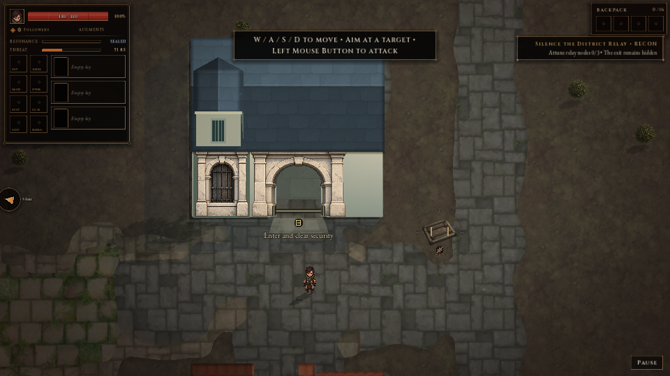

# S3 guard-loggia native evidence

19 October 2026. Baseline `a798043d`; scoped prototype with existing physical rules. [Audit](../../../audits/2026-10-19-s3-guard-loggia.md) · [Machine checks](checks.json) · [Final tests](tests/summary.json) · [Runtime hash matches](capture-hash-checks.json) · [Current source hashes](verified-source-hashes.json).

## Architecture at the actual camera

Both pairs retain seed 1, the same building/terrain/camera/zoom and hidden separable details. Baked base texture detail cannot be individually hidden.

| Size | Guard | Common base |
| --- | --- | --- |
| 1280×720 | [Guard](architecture-final/guard-normal/exterior.png) | [Base](architecture-final/common-normal/exterior.png) |
| 960×540 | [Guard](architecture-final/guard-small/exterior.png) | [Base](architecture-final/common-small/exterior.png) |

## Real native traversal and combat

| Run | Walkthrough | Outside fight | Stills |
| --- | --- | --- | --- |
| South, normal 1280×720 | [Video](native-south-normal/walkthrough.mp4) | [Video](native-south-normal/fight.mp4) | [Exterior](native-south-normal/exterior.png), [entered](native-south-normal/interior.png), [restored](native-south-normal/restored-exterior.png) |
| North, 960×540, Reduced Motion / Flashes Off | [Video](native-north-reduced/walkthrough.mp4) | [Video](native-north-reduced/fight.mp4) | [Exterior](native-north-reduced/exterior.png), [entered](native-north-reduced/interior.png), [restored](native-north-reduced/restored-exterior.png) |

Combined 306 frames, 127 fires, 118 hits, 58 deaths. Both runs pass perimeter movement, production-triggered security clearance, roof fade/restore and identical streamed reload. Scripted input/god mode and controlled exterior crowds are not performance/balance acceptance. Four videos decode cleanly with the demux time base preserved; [decode checks](video-decode-checks.json), per-video encoding metadata and [packaging summary](review-summary.json) preserve details.

| Additional natural entry | Exterior | Interior | Restored |
| --- | --- | --- | --- |
| East | [View](native-entry-east/exterior.png) | [View](native-entry-east/interior.png) | [View](native-entry-east/restored-exterior.png) |
| West | [View](native-entry-west/exterior.png) | [View](native-entry-west/interior.png) | [View](native-entry-west/restored-exterior.png) |
| Recessed irregular | [View](native-entry-irregular/exterior.png) | [View](native-entry-irregular/interior.png) | [View](native-entry-irregular/restored-exterior.png) |

All nine current runs have zero failures, diagnostics and save writes, with 459 matching runtime source/asset hashes. Each has run-results and still/entry/capture metadata. [Production samples](production-samples.json) record natural IDs/roles; [chunk costs](chunk-cost-probe.json) are bounded headless diagnostics. [Strict warnings](final-strict-warnings/results.json) cover fourteen scripts without changing working settings.

## Provenance and limits

`architecture-final` is current. `architecture-review`, first/form/v3 exploratory folders remain locally as earlier iterations, superseded for final hash claims. `production-samples-before-main-street-correction.json` preserves the old incomplete role sweep. Complete original frame sequences, concat lists and isolated runtimes remain local; representative stills, videos, metadata and final logs form the committed packet. Unrelated import/UID/cache artifacts are excluded.

The new family applies only to S3 civic buildings. Other families, topology/gantries, S1/Hub, DonJons and legacy roofless structures remain separate. Presenter acceptance is 64 px/cell with the existing 32-triangle actor limit. Author inspection and passing tests do not assert final designer/human aesthetics or continuous-play acceptance.
