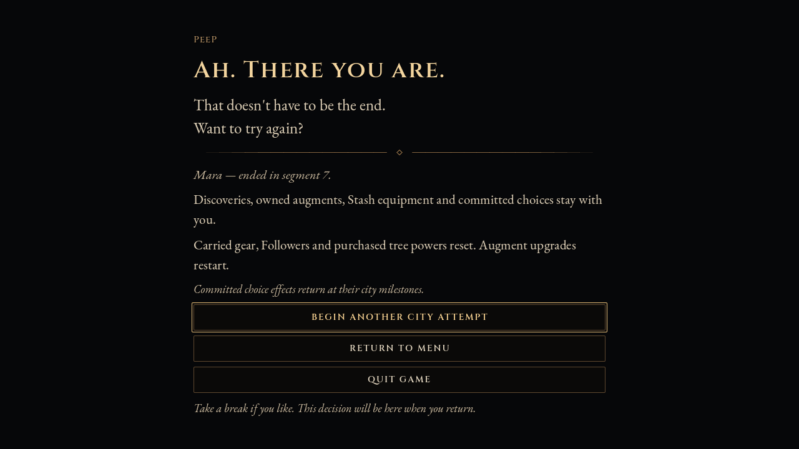

# First-city continuity and pacing iteration

2026-10-16. The first-city prototype is implemented; execution evidence and the known verification exception are recorded below. This pass follows the user's authorization to work autonomously, commit and push. It is a prototype for the next human city run, not a claim that headless checks establish enjoyable pacing.

## Why this pass

The normal October 11 session (`2026-10-11_21-40-44_6760_55563523_1`, historical build `c35ce008d250`) reached segment 8 without developer funding. It completed seven Rites in one uninterrupted twenty-second channel each. S5/S6/S7 enemy HP removed per gameplay second was 137.91/807.98/1146.35; organic Followers per gameplay minute 561.52/1390.29/1618.55. These include alive travel, not combat-only weapon DPS.

Through S7 the capture made 23 paid tree operations on 22 unique IDs, spending 15,257 Followers. Preparation for S8 raised this to 49 operations/45 unique IDs and 28,758 spent. BLINK plus its three mutations cost 7,650 excluding prerequisites. The focused desired engine arrived early; the entire authored tree was not exhausted.

The captured build already had diminishing duplicate contributions, rarity-gap feeding decay and a per-second lifesteal budget. These safeguards must not be proposed as absent. Gospel simultaneously supported Power, Luck and reward-decay defiance; three capped Power contributions still combined to 3.024x. At defiance 0.9, the 35% reward floor becomes 93.5%. This motivates independent farming experiments, not a claim that one item alone caused the outcome.

Evidence: `balance_captures/2026-10-11/2026-10-11_21-40-44_6760_55563523_1/report.md`, `segments.csv`, and `events.jsonl` (S7 ownership near line 27783; later ownership near 33483). Detailed performance incidents came from different early developer sessions. Late-city crowd headroom has not been established; this iteration does not add population.

## Lore provenance

- Current human clarification: PeeP is the multiversal/time-loop catalyst who prevents Syn'tek's death from becoming final.
- Recovered [March Game Lore Assistance](https://chatgpt.com/share/6ad14590-25bc-83eb-bfbc-dea74491e400): the human requests PeeP at the "die-die" encounter asking whether the player gives up. Descriptions of several possible anomaly mechanisms do not select one.
- Recovered [July Project Recovery](https://chatgpt.com/share/6ad144cd-79fc-83ed-a5ee-8cc2b4fdd98e): PeeP cannot die and spans universes/timelines; future creation by Syn'tek remains "maybe".
- The supplied [Tarta chronicle](https://tarta.fandom.com/wiki/Tarta_Wiki) and [Syn'tek article](https://tarta.fandom.com/wiki/Syn%27tek) are older campaign background (the user says roughly a year out of date). They describe the eventual technology deity, continental engineering, reproducible Trinary Rune Magic and aspirational rivalry with the God of Magic. They contain no confirmed PeeP mechanism and do not replace the game's mortal opening.
- The ongoing `docs/history/chat_archive` contains direct original evidence for temporary items versus enduring spells and Followers funding upgrades/reconstruction. It explicitly records incomplete coverage. Archived assistant proposals are not active instructions.

No existing race/boss portrait represents PeeP. The continuation presentation uses the established UI vocabulary rather than inventing a face or an elaborate cinematic mythology.

## What to borrow from other games

[Hades' official FAQ](https://www.supergiantgames.com/blog/hades-faq/) describes permanent progression alongside characters to meet between escape attempts. The useful lesson here is an enduring person and story surrounding a changing combat build. PeeP makes another attempt believable; the retained discoveries and committed choices make the failed attempt matter. This is a design inference, not evidence that a short PeeP scene alone supplies Hades' narrative depth.

[Motion Twin's Dead Cells description](https://motiontwin.com/presskit/) connects repeated attempts to learning, permanent weapon upgrades and progressively unlocked routes. The useful lesson is to preserve access and mastery while giving each traversal an achievable destination. For Synthetic Ascension, the city escape supplies that destination, and the worlds beyond it can extend the ascent later. Requiring a strong player to die would undermine that achievement.

PeeP is permission to continue after failure, not a reward dispenser. This pass adds no payout for repeatedly dying. A successful city build should be allowed to win and leave. Moving the desired Revelation later may improve the city's progression arc; it cannot make finite city enemies challenge unbounded farming forever. The three farming variants test specific feedback loops separately.

## Intended playtest contract

New attempts use milestone access for Revelations after completed S8 and Revelation mutations after S9; Followers still fund the purchase. Existing nonempty legacy ledgers keep their behavior and owned powers. The thresholds are experimental.

Ordinary reconstruction retains the existing build. True defeat produces a durable pending PeeP decision; menu/quit must retain it. Continuing resolves one attempt boundary and starts one new city attempt. Knowledge, owned augment identities, stash and committed city decisions endure; carried equipment, Followers, purchased tree powers and temporary augment growth reset. Commitment effects return at the corresponding 3/6/9 milestone without duplicate benefits.

| Across terminal defeat | Result after accepting PeeP |
|---|---|
| Discoveries, Grimoire/Library and story history | Retained |
| Owned augments and equipped preferences | Retained; their attempt upgrades restart |
| Stash equipment | Exact items/ranks retained, including resale value |
| Method / Doctrine / Apotheosis commitments | IDs retained; effects reactivate after completing S3 / S6 / S9 |
| Carried equipment and bag | Cleared by the existing reset |
| Followers, Congregation and purchased tree powers | Reset |
| Augment levels, Transcendence, Duos, Facets and corruptions | Reset |
| World, checkpoint and pressure | New attempt state |
| Menu or quit before accepting PeeP | Pending decision retained; failed attempt cannot resume |

Stashed equipment remains both power and stored resale wealth. A wealthy profile is an explicit test case. Segment 10 remains an escape/chapter transition, and infinite equipment rarity remains available.

## Independent farming comparisons

After the Godot separator `--`, select any of:

- `--city-no-overtime-drop-bonus`: omit only overtime's extra item-drop probability.
- `--city-no-overtime-rarity-bonus`: omit only overtime's rarity term.
- `--city-gospel-strongest-rewards`: use the strongest Gospel Power contribution and strongest Luck contribution independently while preserving per-instance pressure and other rules.

All variants default off; chosen flags must appear in balance metadata. Compare each separately before combinations. Baseline progression gating is the actual first-city prototype, not evidence that the farming variants have been accepted as final balance.

## Deterministic comparison

The farming fixture uses seed 81919 and 4,096 real item-entitlement rolls at base chance .25 and OT=3. These are controlled mechanics checks, not a city economy or combat playtest.

| Measurement | Baseline | Relevant flag only |
|---|---:|---:|
| Drops, Resonance 1 / Luck 0 | 1,520 | 1,019 |
| Drops, Resonance 1 / Luck 3 | 1,958 | 1,336 |
| Drops, sealed gate / Luck 3 | 1,336 | 1,336 |
| Rarity bonus at S9, full heat, OT=3 | 6 | 3 |
| Three R0 Gospels, sermon counts 1/3/2: Power multiplier | 1.244322494 | 1.2415 |
| Same Gospels: Luck contribution | .36 | .18 |
| Same Gospels: injected pressure seconds | 140 | 140 |

The first three comparisons select only the drop flag; the rarity row selects only rarity; Gospel rows select only strongest rewards. Reversing the unequal Gospel order changes baseline Power to 1.333298838 but leaves the flagged result at 1.2415. Crossed-strength copies also preserve independent maxima: Power 1.2415 and Luck .192, regardless of slot order; removal reveals the surviving copy. Unrelated Cartography Luck and Anchor Rite falloff remain intact.

Gospel defiance is deliberately unchanged. High Luck, stored Stash wealth and other reward feedback still exist, so these switches cannot establish that farming is solved. The human comparison must measure the resulting reason to leave as well as rewards per minute.

## Verification record

Godot 4.7.1 stable console. The combined battery ran 22 relevant suites with 2,749 passing assertion checks and zero failed assertions on the initial source snapshot. **21 suites had verified successful exits; AuditClosureTest is a known teardown failure, not a clean pass.** After the final review correction, the continuation regression passed 92/0, successful developer launches passed 624/0 and the full gameplay parse sweep passed 509/0 again.

| Suite | Passing / failed checks | Process result |
|---|---:|---|
| AscensionCityPacingTest | 624 / 0 | Verified exit 0 |
| CityContinuationTest | 92 / 0 | Verified exit 0 |
| PeePContinuationUiTest | 18 / 0 | Verified exit 0 |
| CityFarmingExperimentsTest | 46 / 0 | Verified exit 0 |
| AscensionLedgerTest | 71 / 0 | Verified exit 0 |
| AscensionLedgerV5RankTest | 74 / 0 | Verified exit 0 |
| AscensionScreenTest | 39 / 0 | Verified exit 0 |
| AscensionPresetTest | 246 / 0 | Verified exit 0 |
| AscensionRuntimeSafetyTest | 21 / 0 | Verified exit 0 |
| StoryDirectorTest | 166 / 0 | Verified exit 0 |
| AttemptResetTest | 18 / 0 | Verified exit 0 |
| SaveMigrationMatrixTest | 34 / 0 | Verified exit 0 |
| DoctrineThesisTest | 89 / 0 | Verified exit 0 |
| AscensionDoctrineTest | 36 / 0 | Verified exit 0 |
| GameOverFallbackTest | 3 / 0 | Verified exit 0 |
| AuditClosureTest | 93 / 0 | Known teardown failure; see below |
| BalanceExitDiagnosticsTest | 35 / 0 | Verified exit 0 |
| ManifestationSystemTest | 162 / 0 | Verified exit 0 |
| ManifestationPairBehaviourTest | 237 / 0 | Verified exit 0 |
| FollowerEconomyV3Test | 134 / 0 | Verified exit 0 |
| ItemEconomyV2Test | 32 / 0 | Verified exit 0 |
| ScriptParseAuditTest | 509 / 0 | Verified exit 0 |

The continuation row uses the final post-review count (92, up from the combined battery's 62). Detailed process exits, log identities, command arguments, variant selections, diagnostic classifications and source snapshots are preserved in [verification.json](evidence/2026-10-16-city-continuity/verification.json). Intentional negative-path diagnostics from save migration, missing game-over presentation and once-only drop/router warnings are distinguished from the teardown failure.

Run a listed scene from the project root with:

`Godot_v4.7.1-stable_win64_console.exe --headless --path . res://tools/tests/<Suite>.tscn`

The real quit check is `PeePContinuationUiTest.tscn -- --peep-quit-check` (5/0, exit 0). Farming modes were checked separately: baseline/drop-only/rarity-only 42/0 each, Gospel-only 44/0, all flags 48/0; the final baseline fixture, including pending-pressure coverage, passed 46/0. Add only the desired flag after `--`. All final focused runs had no script/error/warning diagnostics.

### Existing audit teardown failure

AuditClosureTest completed 93/0 on every observed run. In the shared checkout it then either exited with Windows access violation `0xC0000005`, or returned 0 while reporting leaked shapes, textures, fonts, ObjectDB instances and resources. Two isolated runs of **the exact pre-change commit 629f941** reproduced both outcomes after the same 93/0 summary: one crashed, one returned 0 with the same leak categories. The isolated source was clean; copied ignored asset imports/class cache avoided a new full editor import. This establishes that the failure predates this iteration; its native root cause remains unisolated. No unrelated teardown patch was guessed from the symptom.

The remaining suites exited successfully. Tests ran in the existing shared worktree with unrelated item/character/history/test edits present; these were preserved and excluded from task commits. The baseline comparison used an isolated detached checkout. Under the host's memory pressure, engines were serialized and bounded. A timed-out editor import and an earlier lost process session are excluded from successful evidence.

### Review corrections and commits

Independent task reviews and the whole-change review found and verified corrections for native-Core initialization order in developer launches, terminal save timing before presentation waits, failed-world scheduling/status/pressure during unpause, a queued Hub scene-switch race, and developer shortcuts mutating a pending failed attempt. The final scoped review marks the last P2 addressed, with no remaining or new material findings. UI checks also pin paused acceptance, absent-pending input and small-window arrival/navigation. Invalid fixture runs are explicitly excluded in the evidence record.

Source commits: `c9fb845` (fresh pacing), `993e2c9` (native style ordering), `e89fa11` (pending continuation/commitments), `94d364a` (farming variants), `36c102a` (terminal boundary/world freeze/routing), `a8edc65` (PeeP presentation and captures), `d69ae19` (pending developer-entry guard). Design/plan: `2e59ac7`.

## Presentation evidence

The production scene was rendered through real Godot SubViewports with an offscreen OpenGL window. Worker, root and the fresh UI reviewer inspected the captures. At small sizes the reading area starts at PeeP's greeting; keyboard/controller navigation brings the selected action into view. The screen has no animation, so reduced motion uses the same immediate presentation.

Additional captures: [640×480 arrival](../art/reference/2026-10-16-peep-continuation/small-640x480.png), [640×480 actions](../art/reference/2026-10-16-peep-continuation/small-640x480-actions.png), [960×540 reduced-motion arrival](../art/reference/2026-10-16-peep-continuation/reduced-960x540.png), [960×540 actions](../art/reference/2026-10-16-peep-continuation/reduced-960x540-actions.png).

## Next human comparison

Test in this order:

1. Fresh attempt with no farming flags: test whether the completed-S8/S9 access points leave a satisfying final stretch, including a stocked Stash profile.
2. Add only the overtime drop flag, then only overtime rarity, on matched builds/seeds. Check whether staying behind still dominates leaving.
3. Add only strongest Gospel rewards; compare one, two and three copies and retained pressure.
4. Combine variants only after the individual effect is understood. Keep a no-flag comparison.

Compare fresh and stocked profiles; the captured Momentum/Conduit/Tesla/Gospel route and a different strong build; leave promptly versus stay farming. Record time to desired powers, reasons to leave, meaningful purchases still ahead, effective-rank growth, injury/recovery, Rite interruptions and repeated preparation time. A higher death count alone is not success. The city should deliver a satisfying escape and a reason to try another build after failure.
