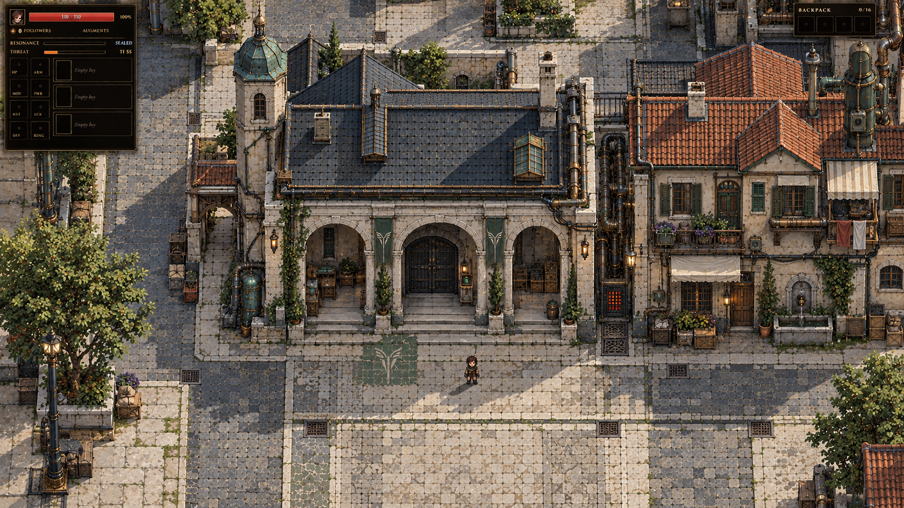
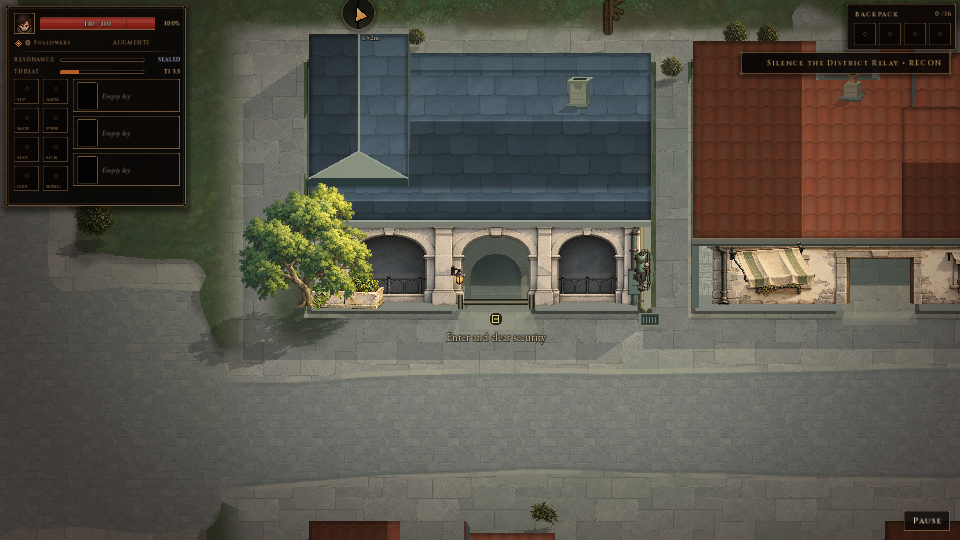
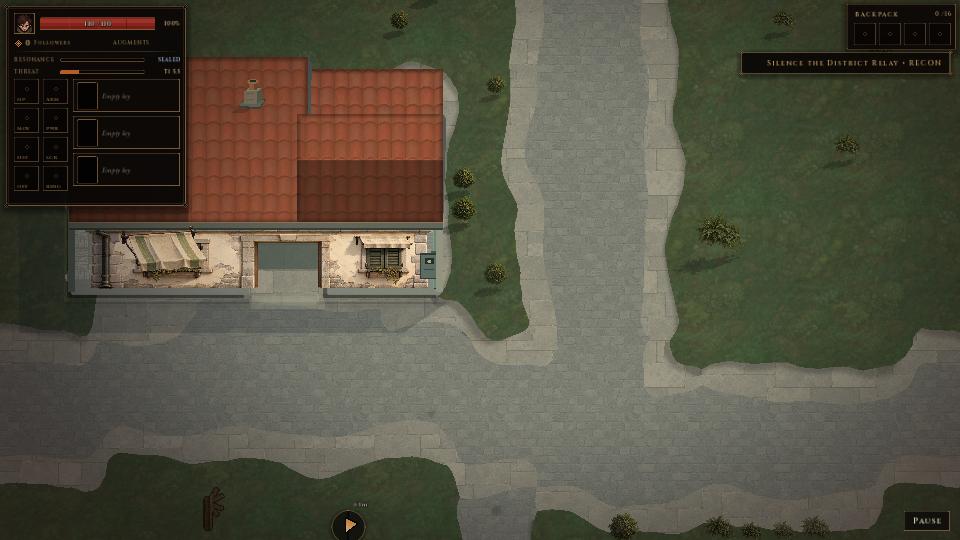
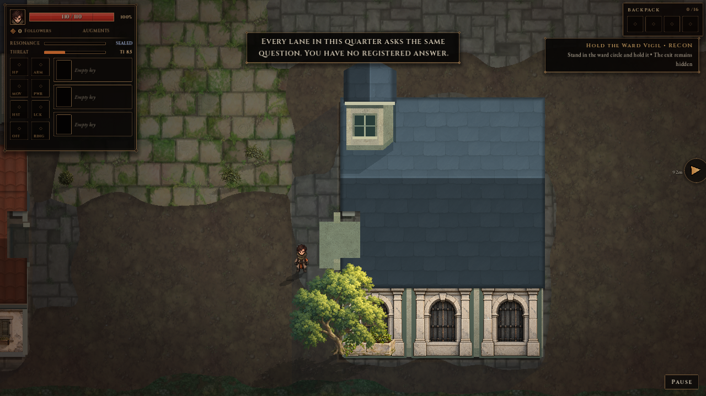

# Synthetic Ascension concept fidelity and production audit

20 October 2026. Baseline `acafb7c53f49e02fc5125f2ca1a14d98de85cdb1`, branch `feat/authoritative-enemy-world`. The human appointed this audit chat as lead designer and authorized retiring or redirecting the four previous chats. This is an initial visual and coordination audit, not acceptance of the game's complete look.

## Verdict

The four chats produced useful assets and real implementation. The shared civic/domestic kit reached ordinary procedural parcels in S2+, and one S3 guard-loggia family received a completed refinement. **The actual generated city remains substantially short of the concept's composition, architectural massing, daylight hierarchy and inhabited infrastructure.** Finishing individual building fixes never closed that larger goal.

The immediate production priority is one convincing **actual generated street**, reviewed as a complete place at the existing gameplay camera. More concept plates or another isolated building family will not by themselves resolve the current gap. Keep the successful foundation and S3 refinements. Establish the street benchmark before expanding distinct families.

All four referenced chats' latest fetched turns were completed at audit time; the designer was idle and the other three were not loaded. The problem is not an observed live infinite execution loop. It is an incomplete larger goal, fragmented ownership/history, some repeated coordination, and review gates that closed narrower tasks.

## Governing art and rejected drift

The governing direction is [08 Mediterranean medieval industrial city](../art/concepts/2026-10-18-city-directions/08-mediterranean-medieval-industrial-city.png), interpreted through the [implementation handoff](../art/concepts/2026-10-18-city-directions/IMPLEMENTATION_HANDOFF.md:17) and [current concept README](../art/concepts/2026-10-18-city-directions/README.md:5).

The human accepted the direction while calling out its over-lined AI appearance. Retain bright temperate daylight, cool limestone/plaster, slate and muted clay, Mediterranean civic bones, inhabited medieval frontage, and restrained practical industrial retrofits. Simplify surface seams and ornament. The concept exaggerates facade depth and uses a more oblique projection than the game: translate its mass, relationships and value hierarchy rather than promising literal pixel matching or silently changing the camera.

The 18 segment/Hub/DonJon/Beyond-the-Wall plates are requested proposals, not 18 implemented environments or individually approved collision layouts. The later four vibe studies were explicitly corrected by the human as too magical. Their glowing cracks, ritual courts and shrine machinery are not district canon. Architecture, everyday use and connected useful infrastructure must establish identity.

## Visual comparison

### Target and current baseline

Concept: varied roof and wall masses, substantial inhabited frontage, a continuous street edge, contained greenery, practical machinery and broad daylight shadows.

Fresh current-source S2: the civic/domestic vocabulary is real and worth keeping. The roofs dominate the facade height; neighboring context and useful service relationships are sparse. This is a controlled environment plate, with the player offscreen and simulation frozen, not ordinary moving play.

Fresh current-source service lane: the broad quiet street is an improvement, but one decorated house beside open lawn and scattered shrub dots does not yet read as the concept's inhabited district.

Current-hash S3: grilles and the supported watch room distinguish the civic family. Coarse dark paving, broad soil, detached surroundings and foliage covering architecture still dominate the overall place. This natural-prop view complements the architecture comparison that deliberately hides optional details.

### Findings and design consequences

| Priority | Observable difference | Next production consequence |
| --- | --- | --- |
| 1 | Concepts form streets from related civic, domestic and service masses; current views often isolate roof-heavy buildings in open terrain. | Compose one reproducible generated street/intersection with neighboring frontage, a service connection and contained planting. Preserve useful combat openings rather than filling every gap. |
| 2 | Concepts have broad readable roof planes and substantial wall/entrance masses; current roof fields and repeated shallow frontage strips dominate. | Judge roof, wall and actor proportions together at 960x540. Improve massing and returns where needed; extra tiny props or color changes cannot substitute. Do not reopen the already closed S3 watch/threshold findings as if they never passed. |
| 3 | S2 has newer quiet streets; later segments retain large dark slabs and rough ground. | Apply material presentation by semantic paved route/frontage/soil policy. Do not globally stamp the S2 rectangular court or pave every district. |
| 4 | Concepts organize trees, planting, gutters and machinery around usable architecture; actual dressing is frequently isolated or repetitive. | Reuse existing tree, planter, awning, lamp and utility assets in purposeful anchored groups. Identify a specific missing module before generating more assets. |
| 5 | Concepts use open daylight and connected directional shadows; actual scenes look flatter/dimmer, with detailed foliage standing out against simpler roofs/ground. | Review value and shadow hierarchy in a whole occupied scene. Avoid a universal brightness/filter change as the only solution. |
| 6 | Most district plates derive identity from structures such as channels, crossings, wall frontage or loading courts. | After the common street benchmark, implement one district's real connected feature at a time. A terrain tint and common buildings do not complete a canal, rail or checkpoint district. |

The concept comparison is a sampled art judgment, not a numerical fidelity score. Root personally viewed the governing concept, S2/S3 plates, prototype street, five fresh S2 small views and current S3 exterior/interior/combat stills. A separate visual auditor inspected 18 source/capture images, including S7/S11 and the rejected vibe studies.

## What the game actually implements

- Fourteen seeded themes across S2-S10, with paired themes as alternatives; S11+ falls back to Service Courtyards. [Selector](../../core/systems/world/proc/SegmentThemePicker.gd:10).
- The common civic/domestic kit is enabled for ordinary S2+ parcels. Noncivic buildings keep the common profile. [Kit policy](../../scenes/world/buildings/CityBlockKit.gd:33).
- Only Checkpoint Lanes selects a bespoke guard-loggia visual profile; the other families resolve to common. [Visual selector](../../scenes/world/buildings/DistrictVisualProfiles.gd:5).
- S3's quiet walls, fuller watch mass and connected cardinal thresholds are finished and reviewed. The latest [S3 v2 record](../art/reference/2026-10-19-s3-guard-loggia-v2/README.md) supersedes older handoff passages that still call those actions pending.
- New streetscape material presentation remains gated to S2. [ChunkManager](../../core/systems/world/ChunkManager.gd:1293), [material binding](../../core/systems/world/ground/GroundSplatRenderer.gd:131). The existing [street follow-up](../design/2026-10-19-district-generation/08-street-material-coverage-follow-up.md) remains unimplemented at this baseline.
- Player/tree, batched enemy and pickup cover cues remain prepared follow-up work, not a completed S3 feature. [Staged visibility contract](../design/2026-10-19-district-generation/09-foreground-and-entity-visibility-packet.md).
- DonJons have a separate implemented enclosure family. S1, Hub, legacy roofless rooms and connected canal/rail/underpass/wall features retain separate scopes. S4A is selected next building-family work, but was not implemented by the audited chats.

## Audit of the four chats

| Chat | Work worth retaining | Limitation or correction | Active role after this audit |
| --- | --- | --- | --- |
| Objective art — visual designer review | Accepted direction, original modular assets, concept inventory, actual screenshot reviews, explicit local findings. | Too much of the larger goal remained outside the current review packet; older summaries conflict with later status. A locally accepted S3 building is not a complete concept-matched district. | Retire from active direction; preserve as source. This audit chat becomes lead. |
| Generate the prototype building families… | Real common-kit rollout, directional/irregular parcel work, shared asset integration, entry/roof/reload verification. | Completed and yielded its lane; later requests should not be sent there as if it still owns production. Shared coverage is not distinct district design. | Retire as completed specialist source. |
| District generation and distinctive… | Actual S3 profile, original arches/material, closed visual defects, meaningful mask regressions and fresh native evidence. | Finished S3 and named subsequent work; no active owner carried the complete city-fidelity goal to a visible street result. | Retire from active production after a fresh single-owner handoff. |
| Refine game vibe concept | Useful observations about missing purpose, ground connections, interrupted ordinary life and readability; helped clarify ownership. | Its four remakes overused magic and were corrected by the human. Reuse observations, not their visual motifs. | Retire; preserve corrected studies as exploratory only. |

No evidence supports throwing away the existing art or blaming a tool for the aesthetic gap. Several reruns fixed real defects: the shared roof-mask budget review and a doorway-notch coverage regression. Some repeated acknowledgments of idle/read-only ownership did add coordination without advancing the visible result.

## Lead designer production decision

This chat owns art direction, comparison against the target, prioritization, asset support and visual acceptance. One fresh production chat owns code/assets/integration in the existing checkout. Old chats remain reference material, not competing approval authorities.

**First milestone: one convincing playable S2 street and its immediate neighbors.** Use the accepted civic/domestic vocabulary and an actual generated service-lane/intersection, not a new authored showcase. The fresh seed16102026 baseline above is the starting evidence. Improve the entire relationship among roof/wall masses, frontages, the walkable street, contained planting and useful service fittings. Root selects this before another family because the fresh baseline reproduces the unresolved whole-place gap directly.

Deliver visible stages, with a first native comparison before a long final packaging pass. Lead reviews each scene-level change against the same target and records keep/rework decisions. Reuse existing assets first; if an essential module is absent, give the lead a precise image/anchor/size brief or generate that module through the approved image workflow. Do not expand an asset catalogue speculatively.

The production queue after that benchmark is: appropriate street-material coverage beyond S2; the already requested player/tree cover cue, then separate enemy/pickup stages; S4A ruined service-hall neighborhood; S4B domestic and S6 service families; connected canal/rail/underpass/wall work as separately reviewed districts. The first milestone does not erase these outstanding human requests or claim all themes are finished.

### Acceptance for the street benchmark

1. Same-location before/after views at normal and 960x540, including the whole street and neighboring buildings after temporary tips clear. Natural foliage and ordinary HUD remain in the principal review set.
2. Civic/domestic/service roles read through silhouette, frontage and useful attachments. Roof fields must not swallow all architectural identity at small size. The place must improve beyond a palette/texture swap.
3. A quieter continuous street/footpath/foundation relationship, with planted pockets and genuinely unpaved ground kept distinct. Preserve irregular route outlines, protected access and combat space.
4. Real physical traversal, doorway entry/exit, roof cutaway/restoration and streamed reload; occupied moving combat at the actual camera. Qualify scripted/god-mode/controlled-spawn samples explicitly.
5. At least one additional naturally generated fit/seed proves that the rule is reusable and not dressing of the captured coordinates. Use relevant deterministic/geometry/roof/material checks; broaden verification when an actual changed path or failure warrants it.
6. A short visual verdict against the six findings above. Passing tests is correctness evidence, not aesthetic acceptance. Lead can accept a bounded improvement while keeping the overall goal open.

## Evidence and coverage

Fresh audit run: 24 native S2 environment plates, 1280x720 and 960x540, seed16102026; exit0, zero diagnostics, failures and save writes. [Manifest](../art/reference/2026-10-20-lead-design-audit/native-s2-16102026/manifest.json), [run result](../art/reference/2026-10-20-lead-design-audit/native-s2-16102026/run-results.json), [source snapshot](../art/reference/2026-10-20-lead-design-audit/audit-source-hashes.json). These plates use actual generated Game parcels but freeze simulation, position the camera independently with the player offscreen, disable ambient spawning/monitoring/pickup processing and use development/god/reduced settings. They prove current environment appearance, not unmodified human play.

The final S3 packet independently matches530/530 recorded source/asset comparisons across ten native runs. All53 unique hashes match current files; no product source changed between tested runtime `7f4c12e6` and audit HEAD. Its moving samples use scripted control, god mode and controlled outside combat. The older S2 release manifest now matches only2/7 files, which is why fresh plates were taken. Old images remain historical evidence.

Only editor PID29136 was present before this audit's engine run. It was left untouched. No product code, game balance, save rules or camera settings were edited; no new regression suite was needed for this read-only audit. No remote Git publication was performed.

The four live references were all read through `read_thread`. Exact matching local transcripts were measured and parsed in bounded fields; no full megabyte records were printed. Child transcripts and every tool-result body were not audited. Older archived game history is incomplete as recorded by its coverage register; no missing human decisions were reconstructed.

### Transcript source map

All paths below are exact local evidence, not portable repository dependencies. D/P/B began with delegated task packets, not new direct human composer prompts. V begins with a direct human screenshot request. Relevant later direct human requests were distinguished from forwarded/injected messages.

| Key | Verified transcript | Lines |
| --- | --- | --- |
| D | `C:/Users/NaurisKrišjānis/.codex/sessions/2026/10/18/rollout-2026-10-18T17-06-52-01a14f56-352f-79b2-b401-d8c10d6ba199.jsonl` | 7240 |
| P | `C:/Users/NaurisKrišjānis/.codex/sessions/2026/10/19/rollout-2026-10-19T14-27-05-01a153ea-44b7-7570-9fe3-e67a5c73ce71.jsonl` | 3460 |
| B | `C:/Users/NaurisKrišjānis/.codex/sessions/2026/10/19/rollout-2026-10-19T08-17-40-01a15298-1259-7381-89bb-bce38d810d95.jsonl` | 3867 |
| V | `C:/Users/NaurisKrišjānis/.codex/sessions/2026/10/19/rollout-2026-10-19T18-51-18-01a154dc-2a54-70c3-81ca-1b43d3e32a4f.jsonl` | 404 |

### Coordination findings with transcript locations

- **Plan adherence and larger goal:** D:6049, direct human request at14:24 Riga on19 October, broadens work to all themes/base buildings/distinct generation. D:6614 records18 concepts; D:6858 explicitly records shared base plus only one bespoke S3 family. B:3853/B:3864 close and yield the base lane; P:3457 closes S3 and names S4A next. These support incomplete production breadth, not a claim that the chats faked all district implementation.
- **Quality evidence:** D:7236 personally reviews14 S3 revision stills; P:3457 reports final verification. Their scope is local refinement. P:1662, P:2824 and P:2877 document real roof-coverage defects and corrections, so those reruns are justified.
- **Request conflicts:** V:180 directly corrects excessive magic; V:401 concedes the correction. D:6868 requests visible street sprites; D:6954 confirms the S2-only material scope. D:7067 asks foreground/enemy/item visibility; D:7154 acknowledges the prepared, unimplemented follow-up.
- **Repeated work:** B:2300, B:2310 and B:2320 successively reconfirm idle/read-only state. This is coordination overhead without visible art progress, not proof that all verification was wasteful.
- **Skill timeline:** D:260 and P:431 evidence applicable skill use. No missing-skill explanation is established. This is a game-production audit, not a diagnosed defect or change request for Superpowers.
- **Stumbles:** stale handoff wording remains visible in the district handoff's pending-S3 sections despite the completed final v2 packet. The current product code and latest accepted evidence must govern new work.
- **Cost/time:** transcript boundaries show bounded S3 turns of roughly126 and57 minutes, including validation/packaging. They do not establish waste, billed cost or pure generation time; no financial estimate is made.

Confidence is high for baseline implementation coverage, current S3 hash applicability, fresh S2 appearance and the cited task boundaries. Visual judgment remains sampled. Whole-run performance, balance and continuous human-play acceptance are outside this audit.

## First lead intervention after the audit

All four old chats were archived, and **Bring a playable street close to the concept**, `01a1583c-19e5-7110-b2d1-57ab06a3d3a6`, started as sole production owner. Its first actual native pass has already been visually reviewed. The lead retained the improved visible wall/roof balance provisionally, but continued the whole-street finding and requested better paving relationships and plain doorway returns. The owner correctly described the first pass as unfinished. See the [specific first review](../art/reference/2026-10-20-s2-street/lead-review-v1.md). These candidate product edits follow the frozen audit baseline; they do not retroactively alter its source snapshot or establish a completed street.

## Subsequent direct human steering

The later [Linux/Windows handoff](../../HANDOFF.md) supersedes the initial sole
Windows production ownership. The human authorized periodic commits/pushes and
assigned Linux the heavy coding/checking, while this lead retains art direction
and supplies/reviews assets. Current headless checks and provisional asset
selection are preserved separately from missing native visual/gameplay evidence.

The human reaffirmed uneven, gradually developed medieval streets, requested tended lawns/flower beds/small fruit trees beside homes while outer greenspace stays wild, and rejected empty domestic interiors with placeholder-looking pale masonry. The [garden and domestic-interior direction](../art/2026-10-20-medieval-gardens-and-domestic-interiors.md) governs the next production review. Coherent streets must not be interpreted as uniform square blocks. An asset-only support chat is creating two garden sprites; ordinary-house character and stronger original masonry are an explicit next domestic packet, not a reopening of completed physical wall repairs.
