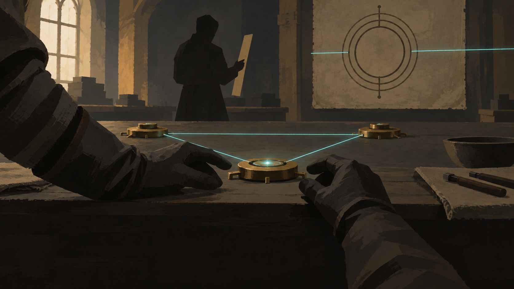

# First city synthesis scene proposal

Draft for review, 16 October 2026. This is a proposed illustrated treatment of the existing first synthesis. It changes no game data or established character designs. The complete storyboard, PeeP scene and optional documents are in [First city story proposal](2026-10-16-first-city-story-proposal.md).

## The third interval

The user selected this unfinished painted version on 16 October 2026 as the style base for this scene and all other shots. Preserve broad strokes, sketch edges, simplified forms, grouped shadows, selective detail and exposed underpainting through production. The composition, apparatus and character designs remain proposals.

The player has made the third alignment. For a moment, nobody is speaking. The spell holds without anything answering it.

This is the representative scene for the opening's art and writing. The discovery should feel small enough to have been made at a workbench and consequential enough that the city will struggle to contain it.

### Composition

A wide, close view across the laboratory bench. The three contacts form one clear arrangement near the centre. The researcher's gloved hands have just released the final contact; their face stays outside the frame. This makes the player the inventor while accommodating the selected mortal identity.

Bren is a plain, dark silhouette at the far side of the bench, holding a measuring strip beside the lattice. The hands and apparatus carry the action. Bren's posture says that a measurement has stopped changing. No character portrait is established by this sketch.

Behind the bench is one recognitional ward: three orderly bands around an empty centre. They remain intact. The new, pale teal line crosses their registration boundary without acquiring any of their marks. It is a visual proposal for failed classification, not a newly named magic system or a literal diagram of how magic works.

Keep the lower quarter quiet and dark for separate, readable dialogue. The image contains no lettering. The workbench, the two sets of hands and the ward are enough; shelves, elaborate machinery and a view of the whole laboratory would weaken the moment.

### Exact text and delivery

After the existing world pulse, hold the image without text for approximately half a second. The pause is skippable.

**Bren, existing line:**

> It worked.

Advance to the existing synthetic response, with the same illustration held behind it:

**First stable synthesis, existing text:**

> No patron answered.\
> No bloodline awakened.\
> The spell worked anyway.

Advance to one proposed additional Bren line:

> Write down every interval. Someone else must be able to follow it.

The new line gives Bren a concrete first response: preserve what the researcher has made so another person can use it. It claims neither authorship nor knowledge of future attempts.

### Sound and motion

The three alignment clicks have already happened through player input. On completion, the workshop hum drops away. One contact settles with a soft metal tick. A thin sustained tone remains; it is quiet enough to hear the room beneath it. No choir, impact boom or heroic fanfare.

One teal line settles from a slight tremor into stillness. There is no camera sweep, burst of particles or repeating pulse. Reduced Motion receives the settled image immediately; reduced flash settings remove the brightness change. All words remain available without sound.

### Return to play

On the last advance, the painted contact aligns with the playable apparatus and dissolves back to the world in about 0.2 seconds. The calibration target becomes the next clear point of attention. Calibration, the construct, the officer's arrest and the player's resistance happen in the existing playable order.

The illustration appears only after a successful alignment. It never performs the discovery for the player. In the short opening, reuse a crop of the settled array behind the existing “KNOWN PATTERN / STABILITY: REPRODUCIBLE” response, with no new speech. Skip remains immediate. Resuming at Calibration or later does not replay this scene. A resume within Synthesis may repeat this illustration because current saves record phases rather than individual cards.

### Single concept image brief

Use case: illustration-story. Asset type: one provisional storyboard still for review, landscape 16:9. A close view across an arcane workshop bench immediately after the first stable manufactured spell. Three simple contacts make one legible array. The mortal researcher's two gloved hands release the final contact in the foreground. A second, anonymous lattice specialist is a small dark silhouette on the far side, holding one measuring strip. One intact recognitional ward on the rear wall has three orderly bands and an empty centre; a single thin teal line crosses its boundary without acquiring a mark. This is the only visual anomaly. Clear focal point at the contact, strong silhouettes, controlled broad brushwork, flat grouped shadows. Charcoal, worn parchment and dull brass; pale teal used sparingly for the new spell. Quiet, held breath, practical workmanship. Keep the lower quarter dark and uncluttered for later dialogue. No lettering, faces, ornate costumes, neon technology, deity imagery, city vista, crowded shelves, sparks, rays, floating symbols or decorative machinery. No polished promotional splash art. This is an economical painted story panel, not a final character or apparatus design.

### Rendering revision prompt

Edit this single provisional storyboard concept. Preserve its composition, the three-contact array, the researcher's gloved hands in the foreground, anonymous lattice specialist in the background, intact circular ward with a thin teal line crossing it, restrained charcoal/parchment/dull brass/teal palette, and quiet lower quarter. Change only the rendering style and density of detail: turn it into an economical hand-painted game story panel with broad opaque brush strokes, very simple grouped values, strong readable silhouettes, simplified shapes and edges. Remove photographic surface detail, wood grain, pores, individual fabric fibres, tiny folds, realistic materials, depth-of-field blur, lens effects, film realism, CGI polish. Make the background specialist a simple anonymous silhouette without distinctive hairstyle or face. Simplify the gloves to large flat shapes. Keep exactly one small bright focal point, the foreground contact, and a fine teal line. No new objects, labels, lettering, sparks, embellishments, or extra effects. The user's chief requirement is controlled painting with minimal detail and no bloated composition. This is the same scene revised, not a new scene or finished game asset.

## Review of writing and composition

The unfinished painted style is selected. Review now centres on the intimacy of the framing and the additional Bren line; the other opening compositions and PeeP's visual treatment remain proposals using the same style base. No full art set has been generated or integrated.
